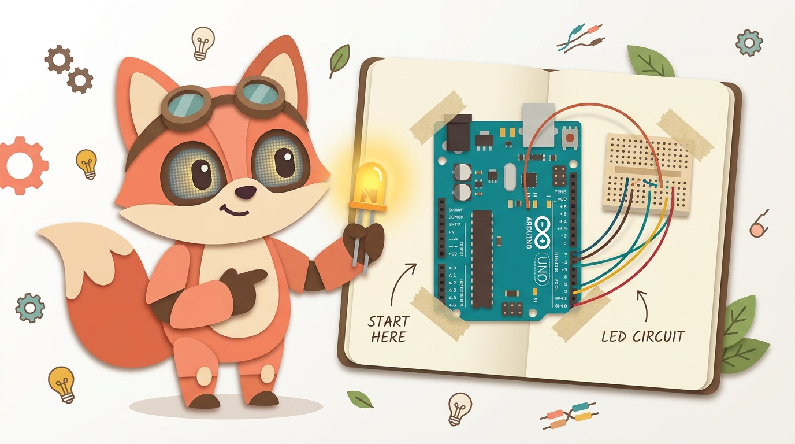

# 🛠️🐾 IoT Help Beginner (Open Source)

<p align="center">
  
</p>

> **ผู้ช่วยคู่ใจนักพัฒนา Hardware IoT มือใหม่** — เปลี่ยน Error ยากๆ ใน Arduino IDE ให้กลายเป็นคำอธิบายภาษาคนจากตัวละครบนหน้าจอ Desktop พร้อมเว็บจำลองวงจรสไตล์ **"รูปแปะกระดาษ (Paper Scrapbook)"** ที่ชี้ให้เห็นทันทีว่าโค้ดที่เขียนผิดส่งผลต่ออุปกรณ์ชิ้นไหน!
>
> **Friendly IoT Hardware Companion for Beginners** — Translates cryptic Arduino IDE bugs into friendly human explanations via a Desktop Mascot and visualizes hardware impact on a **Torn-Paper Scrapbook Circuit Web Visualizer**.

---

## ✨ แนวคิดและจุดเด่นของโปรเจกต์ (Core Features)

1. **🗣️ แปลภาษาคอมพิวเตอร์เป็นภาษาเพื่อน (Human-Friendly Bug Explanation)**
   - แทนที่จะเจอข้อความ Error ยาวๆ เช่น `error: 'Output' was not declared in this scope`
   - ตัวละครจะบอกคุณตรงๆ ว่า:
     - 🇹🇭 *"เฮ้! นายเขียนตัว `Output` ผิดที่บรรทัด 4 นะ นายต้องเขียนเป็นตัวพิมพ์ใหญ่ทั้งหมดว่า `OUTPUT` ไม่งั้นบอร์ดจะไม่จ่ายไฟให้ขา 4 นะ!"*
     - 🇬🇧 *"Hey! You wrote `Output` on line 4. You need to write it in ALL CAPS as `OUTPUT`, otherwise Pin 4 won't configure properly!"*
   - รองรับการสลับภาษา **ไทย (TH)** และ **อังกฤษ (EN)**

2. **📄⚡ เว็บแสดงผลวงจรแบบกระดาษแปะ (Paper-Scrapbook Circuit Visualizer)**
   - ไม่ต้องเสียเวลาปั้นโมเดล 3D หรือต่อวงจรให้เป๊ะทุกเส้น
   - ระบบจะ **อ่านโค้ด Arduino (`.ino`)** แล้วคาดเดาอุปกรณ์ที่คุณน่าจะต่อใช้งานจริง (เช่น หลอดไฟ LED, ปุ่มกด, เซนเซอร์, มอเตอร์)
   - แสดงผลเป็น **รูปอุปกรณ์บนกระดาษฉีกแปะเทปกาว (Scrapbook Cutout)** พร้อมลากสายไฟเชื่อมไปยังขาของบอร์ดอัตโนมัติ
   - หากเขียนโค้ดควบคุมขาไหนผิด อุปกรณ์ที่ต่อขานั้นจะ **ไม่ทำงาน** และมีเครื่องหมาย **`?`** เด้งขึ้นมาบนหัวอุปกรณ์ เพื่อให้เห็นภาพทันทีว่าโค้ดบรรทัดที่ผิดส่งผลกระทบต่อฮาร์ดแวร์ชิ้นไหน!

3. **🐾 ตัวละครผู้ช่วยบนหน้าจอ (Desktop Mascot Companion)** *(อยู่ในแผนเชื่อมต่อเฟสถัดไป)*
   - เฝ้าดูไฟล์โค้ด Arduino ของคุณแบบเรียลไทม์
   - เด้งขึ้นมาพูดเตือนบนหน้าจอ Desktop เมื่อพบจุดผิดพลาด และมีปุ่มพาเปิดเข้าสู่หน้าเว็บ Paper-Scrapbook Circuit Visualizer ทันที

---

## 📁 โครงสร้างโปรเจกต์ (Monorepo Structure)

```text
IoT-Help-Beginner/
├── packages/
│   ├── analyzer/           # ตัววิเคราะห์โค้ด Arduino (.ino) และแปลง Bug เป็นคำพูดภาษาคน + ข้อมูลวงจร
│   ├── web-visualizer/     # เว็บแอปแสดงวงจรแบบรูปแปะกระดาษฉีก (Paper-Scrapbook IoT Visualizer)
│   └── desktop-mascot/     # พื้นที่สำหรับพัฒนา/เชื่อมต่อตัวละครบนหน้าจอ Desktop (WIP)
├── examples/               # ตัวอย่างโค้ด Arduino ที่มี Bug ยอดฮิตของมือใหม่สำหรับทดสอบ
├── CONTRIBUTING.md         # คู่มือสำหรับผู้ที่สนใจร่วมพัฒนา Open Source
├── LICENSE                 # MIT License
└── README.md
```

---

## 🚀 วิธีเริ่มต้นใช้งาน (Getting Started)

### 1. ทดลองเปิดเว็บ Paper-Scrapbook Circuit Visualizer ทันที
คุณสามารถรันเซิร์ฟเวอร์จำลองด้วย Node.js (ไม่ต้องลงไลบรารีหนักๆ เพิ่ม) หรือเปิดไฟล์ `packages/web-visualizer/index.html` บนเบราว์เซอร์ได้เลย:

```bash
# รันผ่านสคริปต์ในโปรเจกต์
node server.js
```
จากนั้นเปิดเบราว์เซอร์ไปที่ `http://localhost:3000`

### 2. ทดสอบตัววิเคราะห์โค้ด Arduino (CLI Demo)
```bash
node packages/analyzer/cli.js examples/blink_bug.ino
```

---

## 🤝 การมีส่วนร่วมพัฒนา (Contributing)

โปรเจกต์นี้เปิดเป็น **Open Source (MIT License)** เปิดรับนักพัฒนาทุกสาย:
- **สาย Arduino / Embedded**: เพิ่มกฎตรวจจับ Bug ยอดฮิตของมือใหม่ใน `packages/analyzer/`
- **สาย Web / UI / ศิลปะ**: วาดรูปอุปกรณ์ IoT สไตล์กระดาษตัดแปะเพิ่มเติมใน `packages/web-visualizer/`
- **สาย Desktop App**: ร่วมเชื่อมต่อตัวละคร Desktop Mascot ใน `packages/desktop-mascot/`

ดูรายละเอียดเพิ่มเติมได้ที่ [CONTRIBUTING.md](./CONTRIBUTING.md)
